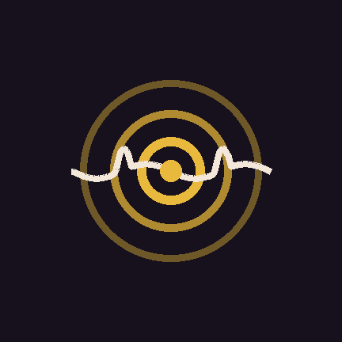

  

# Beats

**Press play. A drummer plays.**

*Why 1.22 on a first release? Beats was developed through a long
run of workshop builds before it ever asked for an audience. This
is its first public release — the number is the résumé.*

Beats is an offline drum app with a real drummer's manners: it
deals songs, takes turns, plays fills, and signs off — it never
just loops one bar at you. The published shelf of its book was
played by human drummers first (the Groove MIDI Dataset, CC BY
4.0 — see the credit in the app and NOTICE.txt).

No account. No ads. No internet — the app carries no internet
permission at all. Nothing about you is collected, because there
is nothing in the app that could collect it.

**Want word when a new version lands?** Tap **Watch** on this
repo and GitHub will notify you when a new release posts. That's
the whole mailing list — we collect nothing, GitHub just tells
you.

## Tip jar

Free — and a tip is never asked for before the work can be
inspected. Run it first. Play with it. Check it yourself. If it
earned it, there is a tip door inside the app, and the jar is
here too — tip once, tip again next month, or never; it works
exactly the same either way:

  <a href="https://cash.app/$streamplay"><strong>💸 Tip Beats</strong></a>

One button. It opens Cash App — you pick the amount there and
confirm.

## What this edition is

- **Front of house** — press play and the beat runs: the house
  drummer, guest drummers, the rotation that deals their turns,
  fills at the joins, held tempos, and pick-your-drummer. A
  hand-built drum kit behind one play button and a visualizer,
  with a 0–200% volume — past 100% a boost stage feeds a ceiling
  limiter, so the phone gets a hotter signal and the peaks are
  caught.
- **The Music Room (core)** — a drawn kit picture: tap a piece
  and write its line on 16 squares. The snare and every tom write
  tap *and* rim; the hats write closed *and* open — the new 1.22
  open hat, with a Spacing hand for how far the cymbals stand
  apart when an open hit rings. Every instrument has its own
  Speed hand and its own Volume hand (0–200%); the kicker has a
  Bump hand. Room tempo, a looping Preview while you edit, a
  plain-words "How this works" card, and a two-tap Reset room.
  Everything saves by itself as you tap, and your rhythm joins
  the drummer's book as "My Rhythm," played on the house turns.

## What this edition is not

Honest edges, in writing:

- **No Toy Cabinet.** The switchable percussion toys are not in
  this build — not hidden, not switched off: the shelf itself
  stands empty in the code, so no composition, written here or
  carried in from another edition, can seat a toy.
- **No Workbench.** The recording bench is not here either, and
  neither is anything that could record: this build asks for no
  microphone permission and its shell contains no recording code
  at all.
- **No guest player, no house rescue buttons.** Those are
  workshop-edition furniture; this front room is play, pick a
  drummer, and the Music Room.
- **No MP3 export.** Beats that leave as audio files are a
  Music Room app feature, not this free build's.

## The Music Room, as its own app

The free kit is the taste. The full room is a separate app, sold
directly — no store, no middleman:

- **Basic Room — $15.** The full Music Room plus the Toy Cabinet:
  twelve percussion toys (bongos, congas, cajon, darbuka, claves,
  cowbell, woodblock, shaker, cabasa, tambourine, frame drum, log
  drum), up to three switched in at once, each with its own line
  and speed hand.
- **Artist Room — $25.** Everything in Basic, plus the Workbench —
  record your *own* instruments on your phone, clean the room
  noise out of them, keep your own library — and **MP3 export**:
  your written beats rendered to real audio files, up to 60
  seconds each (a full song is five or six beats, layered — the
  room makes the ingredients).

**To buy:** tap your tier's price — the link opens Cash App with
the amount already set — and put the tier name AND your own secret
claim word in the payment note (for example: "Artist Room" +
a word only you would pick, like a pet's name plus a number).
That word is how you unlock your key on the claim page later —
pick one nobody can guess, and remember it:

- **Basic Room — $15:** https://cash.app/$streamplay/15
- **Artist Room — $25:** https://cash.app/$streamplay/25

When your payment lands, you're assigned your own User tag
(User1, User2, … — a number, never your name) and your app is
delivered privately against that tag. Your tag is how you claim
updates later. A stolen copy is frozen at the version it stole;
buyers get the updates.

## Your beat, your responsibility

Beats works entirely offline. We do not see, receive, review, or
approve anything you create with it. You are solely responsible
for the rhythms and other content you create, save, share,
publish, or sell using Beats. Only publish or sell work that you
created yourself or have permission to use. If you use protected
material without the rights to do so, you — not the app or its
developer — are responsible for the consequences, and copyright
lawsuits can follow. (The same words stand inside the app, in the
Music Room's info card, where the writer reads them.)

## Install

1. Download `beats-public-1.22.apk` from the latest release —
   in **Attach binaries**, under the release.
2. Open it on your Android phone and allow the install when asked
   (Android calls this "install unknown apps" — it's how apps
   outside the Play Store arrive). First meeting only, your phone
   may ask twice; that's Android, not the app.
3. That's it. No sign-up, no setup. Android 8.0 or newer.

## Permissions — the whole list

Exactly five, and here is every one: FOREGROUND_SERVICE,
FOREGROUND_SERVICE_MEDIA_PLAYBACK and WAKE_LOCK run the
keep-alive so playback survives the screen going off;
POST_NOTIFICATIONS lets its "playing" notice show;
SCHEDULE_EXACT_ALARM rides along with the shared family shell
(this page never sets an alarm). No RECORD_AUDIO. No INTERNET.

## License

MIT. Built by **Songwright**.
